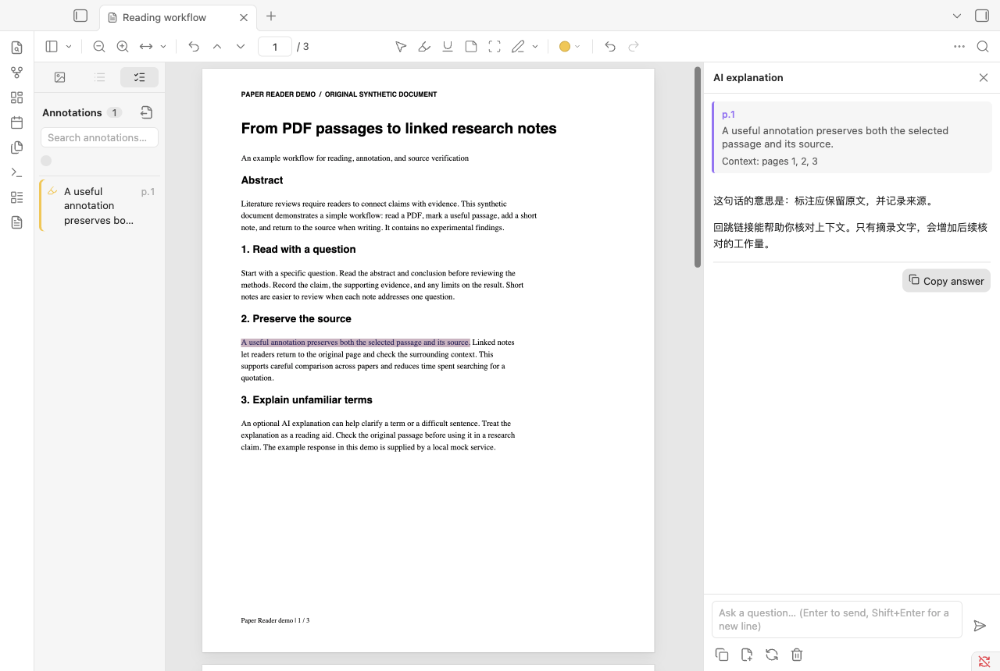
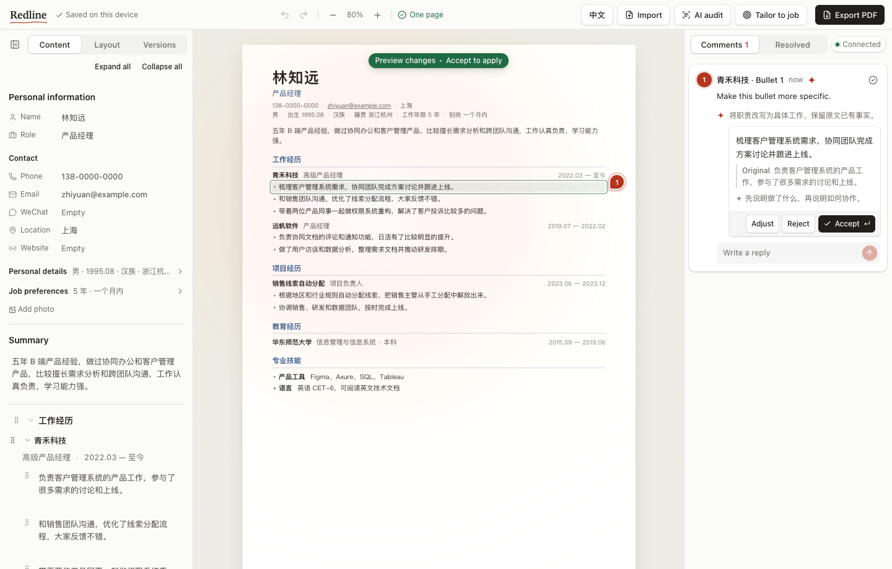

# Hi, I’m zixun

I build local-first AI tools for résumé editing and research workflows. I design AI suggestions so users can inspect them and decide what to apply.

<table>
  <tr>
    <td width="50%" valign="top"></td>
    <td width="50%" valign="top"></td>
  </tr>
  <tr>
    <td><b>Paper Reader</b> · Obsidian plugin for reading papers</td>
    <td><b>Redline</b> · AI résumé review · <a href="https://zixun-ai.github.io/redline-public/redline-demo.mp4">▶ 42-second demo</a></td>
  </tr>
</table>

## Selected projects

- **Paper Reader** lets researchers annotate PDF papers in Obsidian and export Markdown notes that link back to the source page. I built the reading and annotation workflow, with optional AI translation and explanations. It is listed in Obsidian’s community plugin directory, with 260+ downloads and 15 releases since September 2026. [Plugin page](https://community.obsidian.md/plugins/paper-reader) · [Code](https://github.com/zixun-ai/obsidian-paper-reader)
- **Redline** lets job seekers compare AI edits with their original résumé and apply only the changes they choose. It flags some new claims that the original text does not support. I built the review, version history, and PDF export workflows. Each release must pass unit tests, Chrome end-to-end tests, and seven core user journeys. [Watch the 42-second demo](https://zixun-ai.github.io/redline-public/redline-demo.mp4) · [Try it in Chrome](https://zixun-ai.github.io/redline-public/) · [Code](https://github.com/zixun-ai/redline-public)
- **Parallel Task Runner** is a Codex skill I wrote to split work across agents. It defines what each agent owns and how to check the combined result. [Code and usage](https://github.com/zixun-ai/codex-parallel-task-runner-skill)

## How I build

- I test AI features against mocked model responses, including failures, partial output, and retries, so the checks run without an API key.
- I build with Claude Code and Codex, and publish skills that help them plan, divide, and check work.
